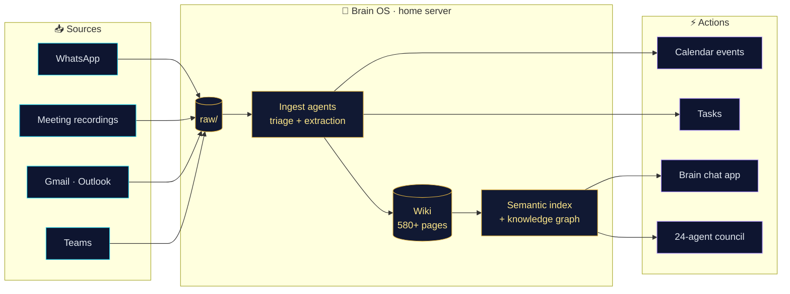

 

  

I'm a finance grad from **Tec de Monterrey** who ended up writing software because the spreadsheets stopped being enough. My day job is **Continuous Improvement at Grupo Senda**, a large Mexican transportation group, where I turn messy operations (fleet, treasury, payroll, maintenance) into AI-powered tools people actually use. On nights and weekends I'm building **[kalu](https://kalu.lat)**, which already has paying customers.

My rule of thumb: **if a task repeats, automate it. If it matters, measure it.**

My most personal project is a **second brain that runs itself**. Every chat, meeting recording, email and Teams thread flows into a structured Obsidian wiki. Agents on an always-on home server keep it up to date, answer questions from my phone, schedule my calendar and run a council of 24 AI advisors when I have a hard call to make.

 

  

<picture>
  <source media="(prefers-color-scheme: dark)" srcset="https://raw.githubusercontent.com/santiagomlr/santiagomlr/output/github-contribution-grid-snake-dark.svg"/>
  
</picture>

<b>Building something in B2B data, AI agents or operations? I'd love to hear about it.</b>

Graphics are hand-built SVGs in this repo; stats refresh automatically every 6 hours via GitHub Actions.

